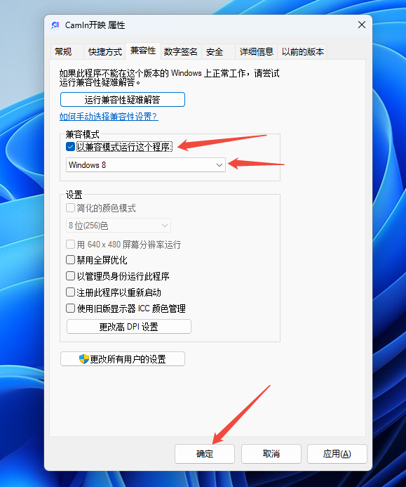

# 😭 CamIn一启动就崩溃怎么办

1.  对于Windows系统，可以先通过改变兼容性来尝试

    * 右键桌面的camin图标，选择属性。然后打开兼容性，按照截图勾选上兼容模式试试。

    
2.  如果兼容性解决不了，可以尝试升级显卡驱动

    * 打开网址[使用虚拟背景后人像消失 | CamIn 开映帮助中心](https://help.camin.cn/faq/shi-yong-xu-ni-bei-jing-hou-ren-xiang-xiao-shi)，按照排查步骤和显卡驱动下载方法升级

    

     
