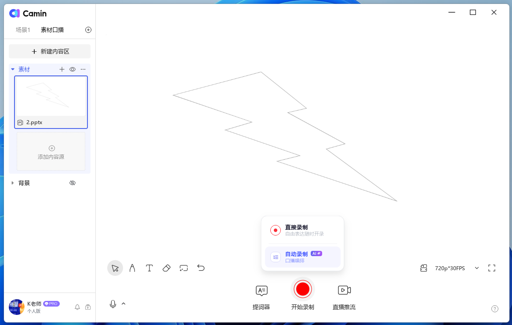
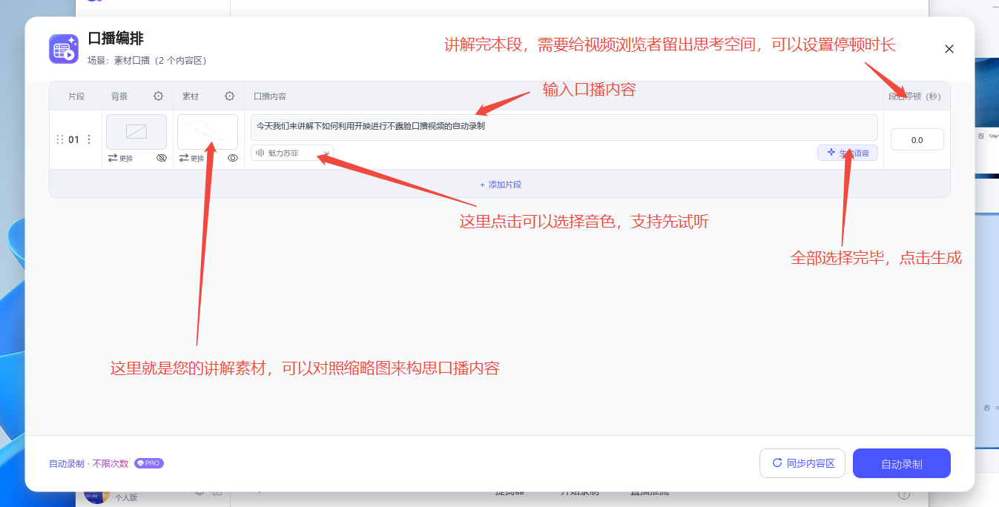
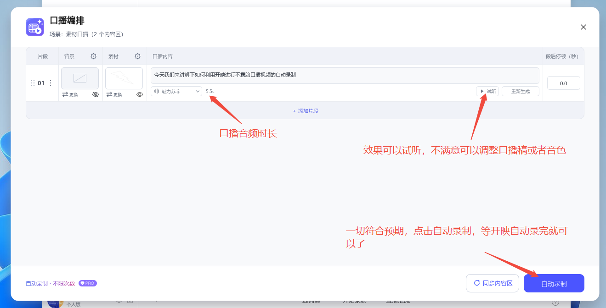

# 🎬 素材口播与自动录制

## 1. 创建素材口播场景

其他场景也可以支持口播和自动录制，素材口播场景支持您纯净录制，无其他内容区干扰。

<figure><figcaption></figcaption></figure>

## 2. 添加需要讲解的素材（ppt、pdf或者图片）

<figure><figcaption></figcaption></figure>

## 3. 点“开始录制”，选择“自动录制”

<figure><figcaption></figcaption></figure>

## 4. 编辑口播内容，选择音色，点击生成后，可以试听。

<figure><figcaption></figcaption></figure>

## 5. 编排完成后，点自动录制，等待自动录制完成进入录制预览就可以了<mark style="color:red;">（中间不需要做任何操作）</mark>。

<figure><figcaption></figcaption></figure>
